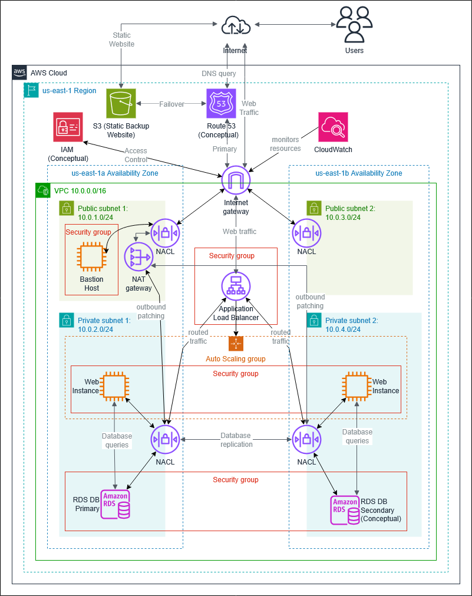

# WinLocal Giveaways: Secure AWS Cloud Architecture

I designed a secure, scalable AWS architecture for WinLocal Giveaways, a fictional Dublin start-up that runs online competitions for local businesses, and built a proof of concept (PoC) of it in an AWS Academy Learner Lab (us-east-1).

WinLocal's on-premises setup was holding it back. An outdated load balancer kept failing and taking the website down, the database server kept running out of disk space, and a flat network had let ransomware attackers move between systems and stay undetected for about ten weeks while they took customer data.

Built for *Security Architecture* (COMP H2701) at TU Dublin. The project had two parts: my individual report (Tasks 1 to 4) and a group presentation on the NIST Cybersecurity Framework 2.0 (Task 5) with Sofiia Prymak and Livia Mathew.

---

## 📂 Repository Structure

```
WinLocalCloudArchitecture/
└── documentation/
    ├── Report_B00168689.pdf                       # My individual report (Tasks 1-4)
    ├── AWS Cloud Infrastructure Deployment.pdf    # Group presentation (Task 5)
    └── architecture_diagram.png                   # Task 1 architecture diagram
```

---

## 🏗️ Architecture (Task 1)

<p align="center"></p>

Drawn in draw.io with the AWS icons. Components labelled *Conceptual* (IAM, Route 53 and a secondary RDS instance) are part of the proposed design but weren't built in the PoC.

---

## ☁️ Proof of Concept (Task 2)

**Networking.** A VPC (10.0.0.0/16) across two Availability Zones, us-east-1a and us-east-1b. Each zone has one public and one private subnet:

| Subnet | CIDR | What runs there |
|--------|------|-----------------|
| Public 1 (us-east-1a) | 10.0.1.0/24 | Bastion host, NAT gateway, load balancer |
| Public 2 (us-east-1b) | 10.0.3.0/24 | Load balancer |
| Private 1 (us-east-1a) | 10.0.2.0/24 | Web instances, RDS database |
| Private 2 (us-east-1b) | 10.0.4.0/24 | Web instances |

An internet gateway serves the public subnets. The private subnets route out through the NAT gateway, so their instances can get patches and updates without being reachable from the internet.

**Bastion host.** A t3.micro running Amazon Linux 2023 in Public Subnet 1. It's the single entry point for administration: you SSH into the bastion, then from there into a private web instance. The private instances only accept SSH from the bastion's security group, so even with the key pair they can't be reached directly from the internet.

**AMI.** I created an AMI from a running web instance that already had Apache, PHP, the web app and the RDS connection set up. New instances launch from it ready to serve traffic, without running the setup script from scratch, and it doubles as a backup if an instance fails.

**RDS.** A MySQL database in a Single-AZ deployment, in a subnet group of the two private subnets, with public access disabled. A simple Address Book web app shows the connection working by reading contact records from the database. The limitation is that an outage in us-east-1a would take the database down with it. A Multi-AZ deployment would add a standby in us-east-1b that takes over automatically.

**Auto Scaling.** A launch template built on the AMI, and an Auto Scaling group with desired and minimum capacity of 1 and a maximum of 2. A target tracking policy keeps average CPU utilisation at 60%. A load test pushed CPU above 60% and the group launched a second instance, and when CPU drops back, the extra instance is terminated after a five-minute cooldown.

**Load balancing.** An Application Load Balancer across both public subnets. It spreads HTTP traffic across the web instances in the private subnets, health-checks them, and stops sending traffic to any unhealthy instance. Loading the ALB's DNS address returned instance IDs from both us-east-1a and us-east-1b.

**Security.** Four security groups, each allowing only the traffic its resources need:

| Security group | Inbound traffic allowed |
|----------------|-------------------------|
| BastionSG | SSH (22) from the administrator's IP only |
| ALBSG | HTTP (80) and HTTPS (443) from anywhere |
| PrivateInstanceSG | SSH from BastionSG; HTTP and HTTPS from ALBSG |
| RDSSG | MySQL (3306) from PrivateInstanceSG |

On top of that, four custom network ACLs filter traffic at each subnet boundary. Because NACLs are stateless, both inbound and outbound rules are set explicitly. The public NACLs allow HTTP, HTTPS and ephemeral ports (1024 to 65535), plus SSH on Public Subnet 1 for the bastion. The private NACLs only allow HTTP, HTTPS and SSH from inside the VPC, plus ephemeral ports for replies to traffic going out through the NAT gateway.

**Static backup website.** A static "competition unavailable" site hosted on Amazon S3, for when the main application goes down during an Availability Zone outage, a failed deployment, or a traffic surge that overwhelms the instances before Auto Scaling can respond.

---

## ➕ Beyond the PoC (Task 3)

**IAM.** WinLocal's ransomware investigation pointed to weak access control, phishing and poor passwords. IAM would give every role only the permissions it needs:

- the developer can deploy application code
- the two system administrators have separate infrastructure permissions, for separation of duties
- accounts and finance only see billing
- marketing gets read-only access to the S3 bucket with campaign assets and entry reports, and to CloudWatch dashboards
- the interns get read-only access to EC2, S3 and CloudWatch

No one has blanket administrator access. Multi-factor authentication would stop a phished password from being enough to get in.

**Route 53.** The PoC has both the load balancer and the S3 backup site, but nothing to switch between them automatically. A Route 53 failover routing policy would fix that: the primary record points to the ALB, the secondary to the S3 site, and health checks on the ALB redirect users to the backup page if the application becomes unreachable, with no manual work from the small team.

---

## 🌱 Sustainability (Task 4)

Measured against the Sustainability Pillar of the AWS Well-Architected Framework:

- **Auto Scaling** runs one instance during normal traffic and only adds a second above 60% CPU, instead of keeping two lightly used instances running all the time.
- **S3** hosts the backup site as a managed, shared service, rather than a dedicated standby EC2 instance.
- **Future improvements:** S3 Intelligent-Tiering, to move older competition data to lower-energy storage, and the AWS Customer Carbon Footprint Tool, to track emissions and set measurable sustainability goals.

---

## 🗣️ Group Presentation (Task 5)

A presentation for WinLocal's owners, in non-technical language. It evaluates the company's security posture and maps recommendations to the six functions of NIST CSF 2.0: Govern, Identify, Protect, Detect, Respond and Recover. Prepared and delivered with Sofiia Prymak and Livia Mathew. My part was the recommended controls and strategies for each of the six functions, and the conclusion.

---

## 📄 Report and Presentation

- The full [report (PDF)](documentation/Report_B00168689.pdf) covers the architecture, every part of the PoC with screenshots, the two additional services and sustainability.
- The [group presentation (PDF)](documentation/AWS%20Cloud%20Infrastructure%20Deployment.pdf) covers the NIST CSF 2.0 security posture review.
